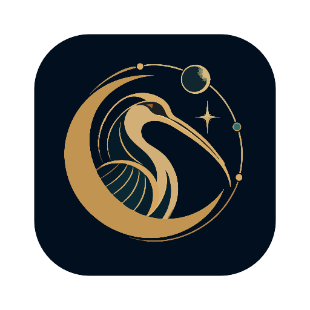

<p align="center">
  
</p>

<h1 align="center">Thoth Browser</h1>

<p align="center"><em>Exploring Human &amp; Browser Interaction in the AI Era.</em></p>

<p align="center"><a href="README.md">English</a> · <a href="README.zh-CN.md">简体中文</a></p>

<p align="center">
  <a href="https://github.com/Aoody743/thoth-browser/releases"></a>
  
  
  <a href="LICENSE"></a>
</p>

<p align="center">
  <a href="https://github.com/Aoody743/thoth-browser/releases">Releases</a>
  &nbsp;·&nbsp;
  <a href="https://github.com/Aoody743/thoth-browser/issues/new">Report an issue</a>
  &nbsp;·&nbsp;
  <a href="https://ladybird.org/">Ladybird engine</a>
</p>

---

Thoth is an experimental browser for macOS, built on the
[Ladybird](https://github.com/LadybirdBrowser/ladybird) engine. Its vertical
sidebar brings workspaces and pages together in one calm, compact place so the
web can take the space it needs.

## A different way to organize the web

- **Workspaces** keep separate projects and their pages together, each with its
  own color and symbol.
- **A vertical sidebar** holds favourites, folders, pinned pages, and temporary
  pages without adding another row above the web page.
- **Split view** keeps two pages side by side under one sidebar entry.
- **Session restore** brings workspaces and open pages back after a restart.
- **A focused address bar** follows the page you are working in.

## Download

Version 0.9.1 targets **Apple Silicon (arm64)** and **macOS 14.4 or later**.
Download the Developer ID-signed and Apple-notarized disk image from the
[0.9.1 release](https://github.com/Aoody743/thoth-browser/releases/tag/v0.9.1).

To install, open the downloaded `.dmg` and drag **Thoth Browser** into
**Applications**.

## Quick controls

| Action | Shortcut |
| --- | --- |
| Focus the address bar | `⌘L` |
| Toggle split view | `⌘⇧S` |
| Close the current page or group | `⌘W` |
| Restore the last closed page or group | `⌘⇧T` |

## Build from source

Follow the prerequisites in the
[Ladybird build instructions](Documentation/BuildInstructionsLadybird.md), then
build and run Thoth on macOS:

```sh
python3 Meta/thoth.py build -j 6
python3 Meta/thoth.py run --no-build
```

To make a self-contained local application bundle:

```sh
python3 Meta/package_thoth.py
```

The packaged application is written to `Build/0.9.1/Thoth Browser.app`.
Local packages are ad-hoc signed for development. The GitHub release is signed
with Developer ID and notarized by Apple.

## Project status

This is an early preview. Ladybird is an actively developing browser engine, so
some websites and browser features may not work as expected. This release is
for trying the interface and providing feedback.

An experimental Windows (x64) build is also available. It builds the Qt shell
and the Ladybird engine with MSVC/clang-cl, produces `Thoth.exe`, and paints web
content through Qt's software path for compatibility. See
[Documentation/WindowsBuild.md](Documentation/WindowsBuild.md) for prerequisites,
build commands, packaging, and the current Windows limitations.

## Credits and license

Thoth is an independent project based on the work of the Ladybird developers.
It is distributed under the [BSD 2-Clause license](LICENSE); third-party
components retain their respective licenses. Thoth Browser is not an official
Ladybird release.
